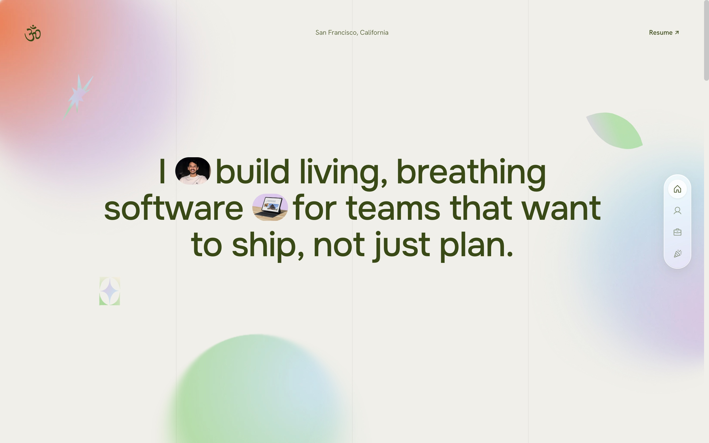

# Pranav Reddy Gaddam



My personal site. It replaced a gamified portfolio with levels, XP and an 8-bit interface, which still lives at `/v1`. This version is quieter: a cream page, a short line about what I build, and the work itself up front.

- **Work** is a scrollable project wheel. Pick a project and its case study opens beside it on desktop, or in a modal on phones.
- **About** covers my experience and a live GitHub contribution graph.
- **Fun** collects music, film and TV, places, sport and the tools I use.

Built with React, TypeScript and Vite, styled with Tailwind and hand-written CSS, and animated with GSAP. It's deployed on Vercel, where two serverless functions pull my GitHub stats.

## Running it

```sh
cd frontend
npm install
npm run dev
```

The GitHub graph needs a `GITHUB_TOKEN` environment variable. The rest of the site runs without it.
